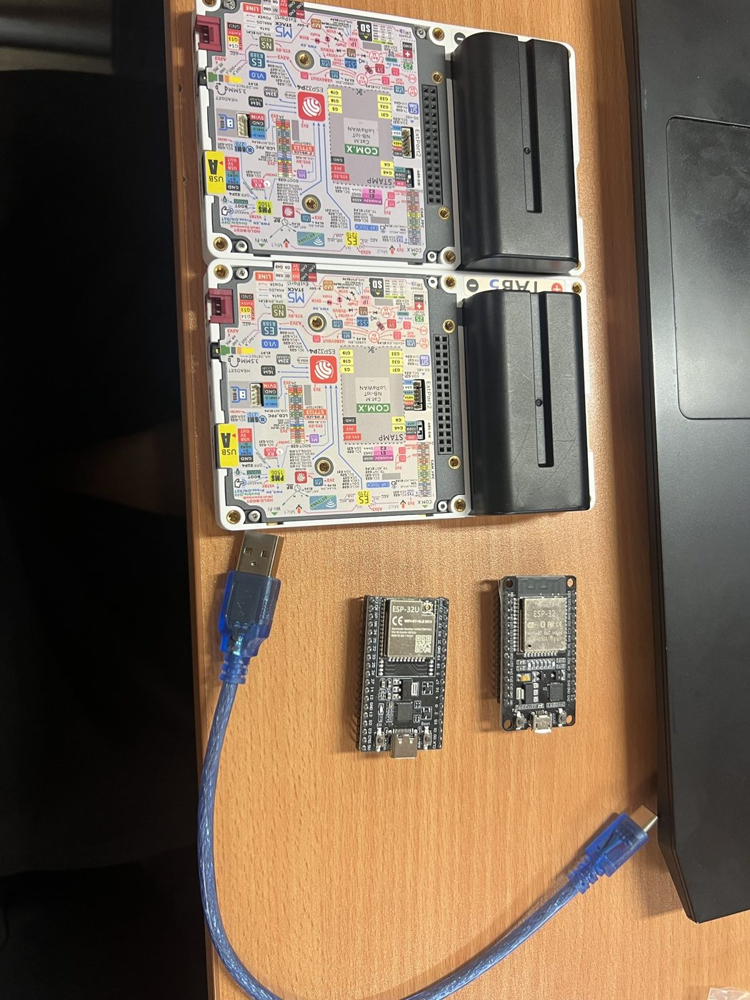
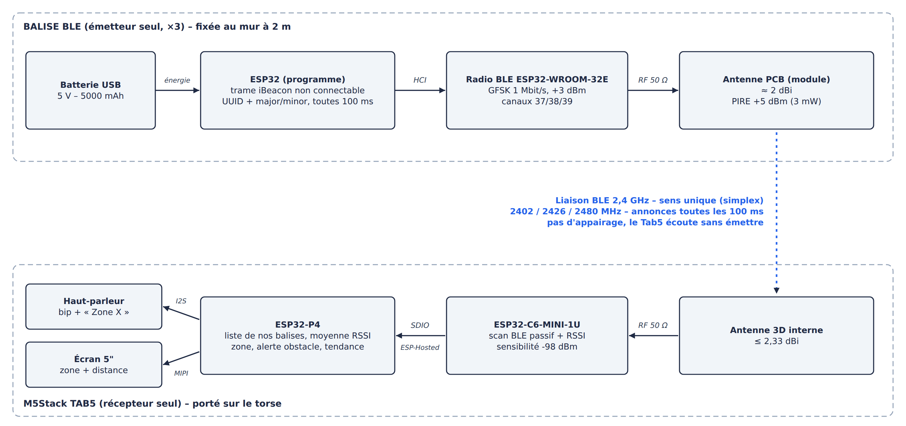
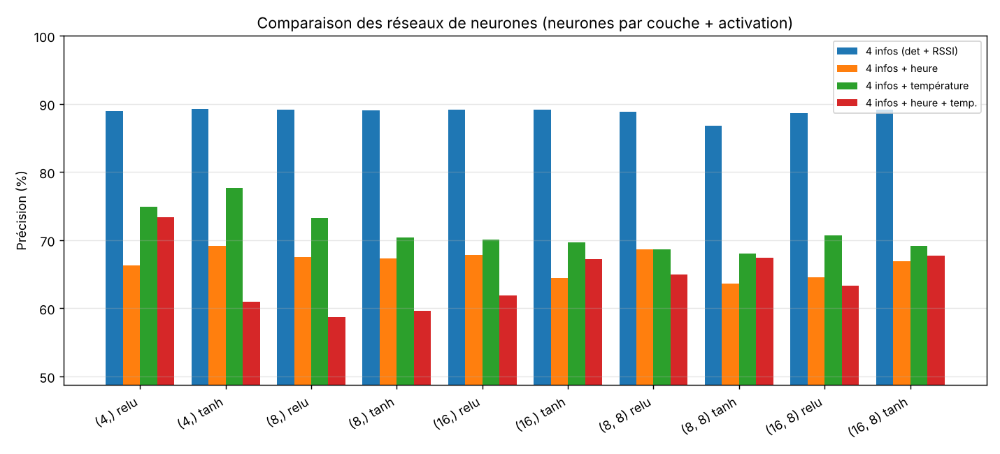

# TAB-Géoloc

Aide au déplacement pour personne aveugle, avec un **M5Stack Tab5** porté sur le torse et des **balises Bluetooth (BLE)** posées dans un bâtiment.
Le Tab5 écoute les balises, estime la proximité d'un obstacle et prévient l'usager par des **bips** et une **voix**.

Projet SEE5 – ISTY (démarche SysML) · Formateur : M. LATRACHE
Équipe : **Samy SERRAKH**, **Ismaël BENREZZOUG**, **Steffy ANNICK**



## Avancement

| Étape | Contenu | État |
|---|---|---|
| 1. Fiche projet SysML | Exigences, cas d'utilisation, diagrammes de séquence, budget | Fait |
| 2. Spécifications radio | Spec Wi-Fi (liaison entre 2 Tab5) et spec BLE (balises → Tab5), avec notes de justification et schémas bloc | Fait |
| 3. Prototype Wi-Fi | 2 Tab5 en Wi-Fi : mesure du RSSI, interface « GPS rétro » | Fait |
| 4. Balises BLE | 2 ESP32 qui émettent une trame iBeacon (ZONE et OBSTACLE) | Fait |
| 5. Tab5 récepteur BLE | Bip « radar de recul », direction de l'obstacle (gyroscope), voix | Fait |
| 6. IA : niveau de danger | Collecte de mesures dans la salle, analyse et entraînement d'un réseau de neurones, décision sur le Tab5 | En cours (mesures à faire) |

## Organisation du dépôt

```
docs/            fiche projet SysML, spécifications radio, schémas, photos du matériel
prototypes/      premiers essais en Wi-Fi entre 2 Tab5 (test de liaison, interface GPS rétro)
balises/         programmes des 2 balises BLE (ESP32) : ZONE (Samy) et OBSTACLE (Steffy)
tab5_ble/        Tab5 récepteur BLE : bip radar + direction de l'obstacle + voix (Ismaël)
ia/              apprentissage du niveau de danger par réseau de neurones
```

## Architecture



- **Balises** : ESP32 (ESP-32 et ESP-32U avec antenne externe), trame iBeacon non connectable, +3 dBm, toutes les 100 ms.
- **Tab5** : écoute passive (il n'émet pas), filtre le RSSI (médiane + lissage), décide et prévient l'usager.

## Partie IA (étape 6)

Le réseau de neurones décide du **niveau de danger** : `LOIN`, `PROCHE` ou `TRES PROCHE`.

**Entrées (4 informations, 2 par balise) :** balise détectée (1/0) et RSSI filtré.
**Paramètres testés en plus :** l'heure (codée en sinus/cosinus) et la température.

**Démarche « ad hoc » (environnement connu) :** on mesure dans la salle réelle à des distances connues de la balise OBSTACLE, puis le programme `analyse_reseau.py` :
1. compare **40 configurations** (4 jeux d'entrées × 5 architectures × 2 activations) ;
2. évalue chaque réseau sur des **enregistrements jamais vus** (validation croisée par enregistrement) ;
3. garde le meilleur (le plus petit à précision égale) et l'exporte en C dans `ia/Tab5_IA/modele.h`.

Le calcul du réseau sur le Tab5 a été vérifié : mêmes probabilités qu'en Python (écart < 0,000002).

### Utilisation (Windows, double-clic dans `ia/`)

| Script | Rôle |
|---|---|
| `0_installer.bat` | installe les bibliothèques Python (une seule fois) |
| `1_envoyer_collecte_sur_Tab5.bat` | compile et envoie le programme de collecte sur le Tab5 |
| `2_enregistrer_mesures.bat` | enregistre les mesures envoyées par le Tab5 dans `mesures/` |
| `3_entrainer_reseau.bat` | compare les réseaux, entraîne le meilleur, crée `modele.h` et les graphiques |
| `4_envoyer_IA_sur_Tab5.bat` | envoie le programme IA (avec le nouveau modèle) sur le Tab5 |

Prérequis : Arduino IDE 2 avec le paquet de cartes M5Stack (3.3.x), les bibliothèques M5Unified et M5GFX, et Python 3.

### Résultats sur mesures simulées (en attendant les vraies mesures)



Sur ces données simulées, ajouter l'heure ou la température fait **baisser** la précision : ces valeurs ne changent pas pendant un enregistrement, et le réseau finit par mémoriser les enregistrements au lieu d'apprendre le lien avec la distance. À confirmer avec les vraies mesures.

## Limites connues

- Le RSSI varie beaucoup en intérieur (réflexions sur les murs, corps de l'usager) : on travaille par niveaux plutôt qu'en mètres.
- Avec une seule antenne, la direction de l'obstacle demande que l'usager tourne sur lui-même. Une antenne patch directive sur la prise SMA du Tab5 améliorerait nettement la précision.
- Pour une précision au centimètre, il faudrait de l'UWB (Ultra Wide Band) : piste pour la suite.
